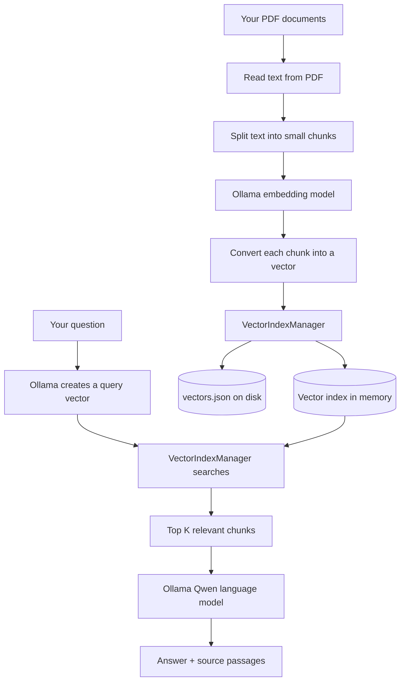
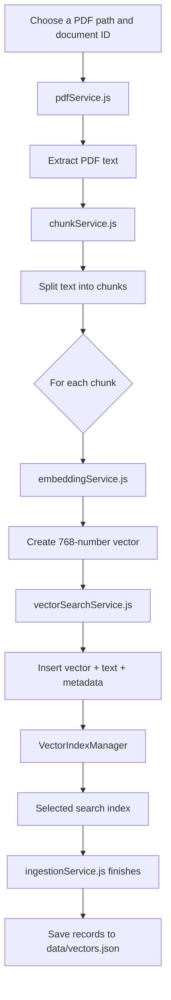
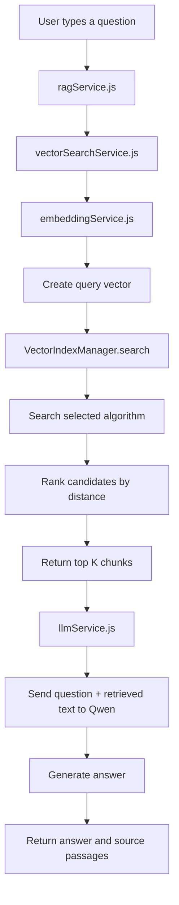
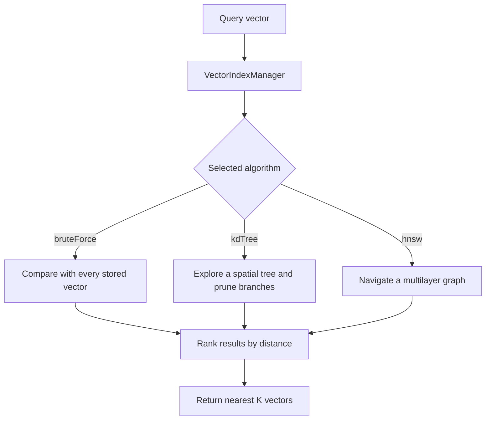
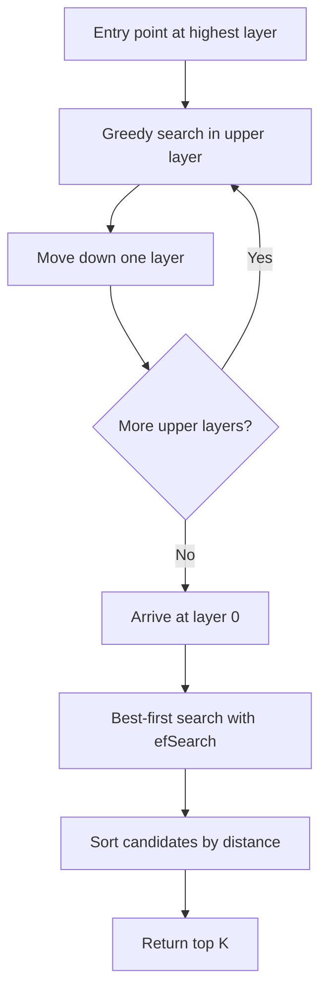
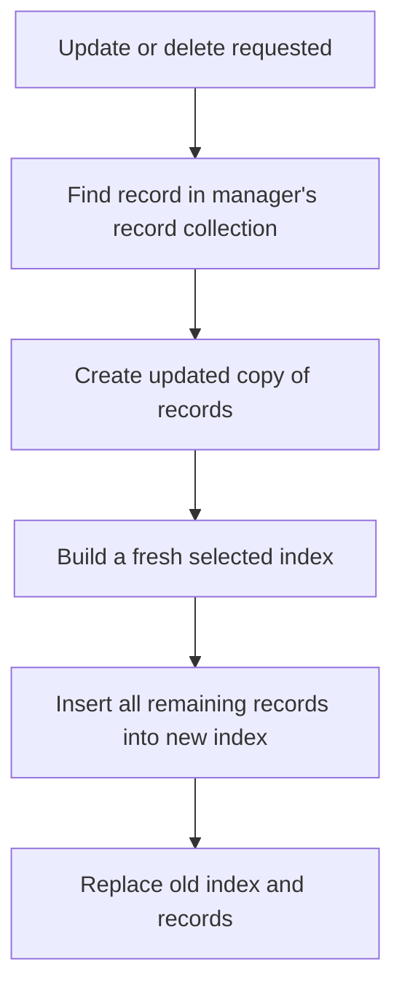

# JavaScript Vector Search Engine + Personal AI Assistant

A learning-focused project that stores text as numerical vectors, finds relevant passages by meaning, and uses a local language model to answer questions from uploaded PDF documents.

> **Main idea:** Add a PDF → break it into small passages → turn each passage into numbers → store those numbers → ask a question → retrieve relevant passages → let the AI write an answer using those passages.

This is an educational prototype, not a production vector database.

---

## How to read this README

The project is explained in small chunks. Read them in order the first time. Later, use the maps as a quick reminder of how information moves through the application.

1. [The whole project in one picture](#chunk-1--the-whole-project-in-one-picture)
2. [What each part does](#chunk-2--what-each-part-does)
3. [How a PDF is stored](#chunk-3--how-a-pdf-is-stored)
4. [How a question is answered](#chunk-4--how-a-question-is-answered)
5. [How the vector search algorithms work](#chunk-5--how-the-three-search-methods-work)
6. [Update and delete](#chunk-6--update-and-delete)
7. [Save and restore](#chunk-7--save-and-restore)
8. [Project file map](#chunk-8--where-to-find-the-code)
9. [Run the application](#chunk-9--run-the-application)
10. [Important limitations](#chunk-10--what-this-project-does-not-do)

---

# Chunk 1 — The whole project in one picture

Imagine putting your study PDFs into a personal knowledge assistant. Later, you ask a question in normal English. The application finds passages that seem relevant and asks a local AI model to write an answer using those passages.



**In plain language:** the embedding model helps the application compare meaning; the vector engine finds relevant passages; the language model turns those passages into an answer.

---

# Chunk 2 — What each part does

| Part | Think of it as | Responsibility |
|---|---|---|
| PDF reader | A person reading a document | Extracts selectable text from a PDF |
| Chunking service | A person dividing a book into pages of notes | Splits long text into smaller pieces with a little overlap |
| Embedding model | A translator from text into numbers | Converts a passage or question into a numerical vector |
| Vector engine | A filing system organised for similarity | Stores vectors and finds the nearest ones |
| Qwen language model | A writing assistant | Writes an answer using the retrieved passages |
| JSON file | A cupboard on disk | Keeps stored records after the program closes |

## The two Ollama models

| Model | Used for |
|---|---|
| `nomic-embed-text:latest` | Creating vectors from document passages and questions |
| `qwen3.5:2b-q4_K_M` | Writing an answer from the retrieved passages |

The project does **not** train these models. It calls the models already running locally through Ollama.

---

# Chunk 3 — How a PDF is stored

When you choose **Add PDF document**, the application follows this path:



## What is a chunk?

A chunk is a small section of a larger document. The current chunking function uses a default of **120 words per chunk** with **20 words of overlap**.

```text
Document text

Chunk 1: words   1 ───────────────── 120
Chunk 2:                    101 ───────────────── 220
Chunk 3:                                        201 ───────── 300

                   <---- 20 overlapping words ---->
```

The overlap keeps a little context between neighboring chunks, so a useful sentence near a boundary is less likely to become isolated.

Each chunk is stored with information such as:

- `documentId` — which PDF it came from
- `chunkNumber` — its position within that PDF
- `totalChunks` — the total number of chunks for that PDF
- `source` — the original PDF path
- `text` — the original passage

The vector is used for similarity search. The original text is kept so it can later be shown to the language model and to the user.

---

# Chunk 4 — How a question is answered

When you choose **Ask a question**, the application follows this path:



## What does “top K” mean?

`K` is simply how many matching passages the search should return. For example, if `K = 3`, the vector engine returns its three nearest matches.

The current command-line application asks for the top **3** passages. A smaller distance means a closer match for the configured distance metric.

## Why do we embed the question too?

The saved passages are represented as vectors. To compare a question with them, the question must be represented in the same vector space using the same embedding model.

For `nomic-embed-text`, the service uses:

- `search_document:` for passages being stored
- `search_query:` for the user's question

The resulting vectors are then compared by the vector engine.

---

# Chunk 5 — How the three search methods work

The three algorithms solve the same basic task: find the stored vectors closest to the query vector. They differ in how they look for those matches.



| Algorithm | Simple explanation | Search type in this project |
|---|---|---|
| Brute Force | Checks every stored vector | Exact |
| KD-Tree | Organises vectors in a tree and can skip branches | Exact for the supported metrics in this implementation |
| HNSW | Navigates a graph to explore promising candidates | Approximate; it can miss some true nearest neighbors |

### HNSW traversal map

HNSW has several graph layers. The search starts from an entry point in an upper layer, uses greedy movement to get closer to the query, and descends layer by layer. It then performs a broader search in layer 0.



Important HNSW terms:

- **Entry point:** the node used to begin navigation.
- **Layer:** one level of the graph. Every node belongs to layer 0; only some nodes appear in higher layers.
- **`M`:** controls the connection limit used when building the graph (layer 0 has a limit of `2 × M` in this implementation).
- **`efConstruction`:** controls how broadly insertion searches for potential neighbors.
- **`efSearch`:** controls how broadly a query searches at layer 0. Raising it often improves recall but takes more work.

The benchmark experiments showed that HNSW is not automatically faster for every dataset. Its usefulness depends on dataset size, dimensions, graph settings, and the desired recall.

---

# Chunk 6 — Update and delete

Brute Force and KD-Tree have their own update/delete behavior. Our HNSW implementation does not have native graph update/delete operations.

To keep one simple behavior across all three algorithms, `VectorIndexManager` keeps a private collection of the original records. When a vector is updated or deleted, the manager builds a fresh index from the remaining records and replaces the old index after the rebuild succeeds.



For deleting a whole PDF, `deleteDocument(documentId)` removes every stored chunk whose metadata has that document ID, then rebuilds the index.

**Trade-off:** rebuilding is simple to understand, but it can be slow for large collections. This is acceptable for the current learning prototype.

---

# Chunk 7 — Save and restore

Vectors in memory disappear when the Node.js application stops. The manager therefore saves the original records and their metadata in `data/vectors.json`.

```mermaid
flowchart TD
    A[Application running] --> B[Vector records in memory]
    B --> C[save()]
    C --> D[(data/vectors.json)]
    D --> E[Application starts later]
    E --> F[load() reads JSON]
    F --> G[Reinsert saved records into selected index]
    G --> H[Search can continue]
```

The JSON file stores the records, algorithm name, and index options. The application rebuilds the index from those records when it loads them; it does not save the internal HNSW graph itself.

Default storage path: `./data/vectors.json`.

---

# Chunk 8 — Where to find the code

The main files and their jobs:

```text
vector-engine-js/
│
├── src/
│   ├── app.js                         # Command-line application menu
│   │
│   ├── core/
│   │   ├── indexManager.js             # Stores records and coordinates the chosen index
│   │   ├── bruteForce.js               # Exact search by checking every vector
│   │   ├── kdTree.js                   # Tree-based vector search
│   │   ├── hnsw.js                     # Graph-based approximate vector search
│   │   ├── distance.js                 # Vector distance calculations
│   │   └── priorityQueue.js             # Candidate queues used by HNSW
│   │
│   └── services/
│       ├── pdfService.js               # Reads text from PDF files
│       ├── chunkService.js             # Splits text into overlapping chunks
│       ├── embeddingService.js         # Calls Ollama Nomic embedding model
│       ├── vectorSearchService.js      # Embeds text and calls the index
│       ├── ingestionService.js         # PDF → chunks → embeddings → index
│       ├── llmService.js               # Calls Qwen to generate an answer
│       └── ragService.js               # Search → answer → source passages
│
├── data/
│   ├── documents/                      # PDF files supplied to the application
│   └── vectors.json                    # Saved vectors and metadata
│
├── tests/                              # Automated tests (run in final verification)
├── benchmarks/                         # Search performance experiments
├── package.json
└── README.md
```

Some files may be absent if you have not created that part of the project yet. The tree above describes the intended structure from the implemented workflow.

---

# Chunk 9 — Run the application

## Requirements

- Node.js (the project has been developed using Node.js 24).
- npm.
- Ollama running locally.
- `nomic-embed-text:latest` for embeddings.
- `qwen3.5:2b-q4_K_M` for answer generation.
- The npm package `pdf-parse` for reading PDFs.

Check Ollama models:

```powershell
ollama list
```

If a required model is missing, pull it:

```powershell
ollama pull nomic-embed-text
ollama pull qwen3.5:2b-q4_K_M
```

Install project dependencies if needed:

```powershell
npm install
npm install pdf-parse
```

## Start the application

From the project root:

```powershell
node src/app.js
```

If the `app` script has been added to `package.json`, you can also run:

```powershell
npm run app
```

## Application menu

```text
================================
       PERSONAL AI ASSISTANT
================================

1. Add PDF document
2. Ask a question
3. View documents
4. Delete a document
5. Exit
```

### Add a PDF

- Enter a path, for example: `./data/documents/sample.pdf`
- Enter a unique document ID, for example: `fundamentals`
- The application extracts, chunks, embeds, indexes, and saves the document.

### Ask a question

Type a question about the information in your uploaded PDFs. The application retrieves up to three relevant chunks by default and sends them with the question to Qwen.

### View or delete documents

The document list shows each document ID, source path, and chunk count. Deleting a document removes its stored chunks from the collection; it does **not** delete the original PDF file from your computer.

---

# Chunk 10 — What this project does not do

To keep the project manageable and explainable, the current version has deliberate limitations:

- It reads selectable text from PDFs. Scanned/image-only PDFs need OCR, which is not included.
- It uses local Ollama models; it does not train an embedding model or language model.
- It uses JSON for persistence, not a production database.
- It uses a command-line menu, not a web interface or REST API.
- HNSW update/delete is handled by rebuilding the index through the manager, not by editing graph links in place.
- HNSW is approximate and may not return every true nearest neighbor.
- The current chunking method splits by word count, not by document structure or token count.
- Answer quality depends on the retrieved passages and the local language model. The model can still misunderstand or omit details.
- The prototype is intended for learning and interview demonstration, not concurrent production workloads or very large collections.

## The project in one sentence

**A local application that lets a user upload PDFs, finds passages related to a question using a custom JavaScript vector search engine, and asks a local AI model to answer using those passages.**

---

## A suggested learning path

Use the diagrams as a map and learn one path at a time:

1. Understand [how a PDF is stored](#chunk-3--how-a-pdf-is-stored).
2. Trace [how a question is answered](#chunk-4--how-a-question-is-answered).
3. Learn [how the three search methods work](#chunk-5--how-the-three-search-methods-work).
4. Review [update/delete](#chunk-6--update-and-delete) and [save/restore](#chunk-7--save-and-restore).
5. Open only the source file named in the relevant map when you want to inspect its implementation.

The goal is to be able to explain the flow from memory—not to memorize every line of code.
